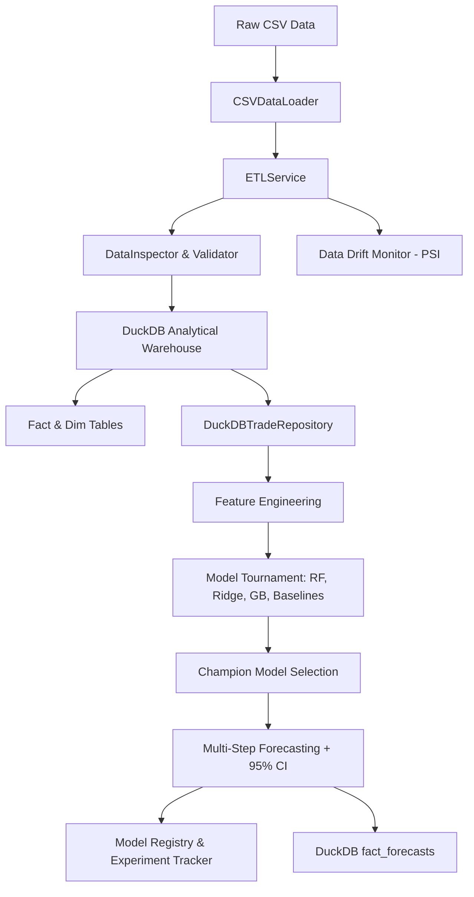

# AquaTrade MLOps 🐟📊

An enterprise-grade, end-to-end MLOps pipeline and analytical time-series forecasting system tailored for global aquaculture trade data.

---

## 📌 Executive Summary

**AquaTrade MLOps** ingests, validates, standardizes, stores, and forecasts trade statistics (imports, exports, volumes, values, and unit prices) for aquaculture commodities. Built using strict **Domain-Driven Design (DDD)** and Clean Architecture principles, the system decouples infrastructure dependencies, domain rules, and application services to provide:

1. **Automated ETL & Metric Calculations**: Ingests 280k+ raw trade records, formats temporal dimensions, and calculates weighted unit prices and trade balances.
2. **Analytical High-Performance Data Warehouse**: Persists normalized star-schema fact and dimension tables into DuckDB (`fact_trade`, `dim_commodity`, `dim_geography`, `fact_forecasts`, and optimized analytical views).
3. **ML Time-Series Tournament Engine**: Generates lag, rolling window, seasonal cyclical, and trend features to train and evaluate candidate algorithms (`RandomForest`, `GradientBoosting`, `RidgeRegression`, `LinearTrend`, `SeasonalNaive`, `MovingAverage`, `Naive`) through rolling-origin backtesting.
4. **MLOps Tracking & Model Registry**: File-backed experiment logging (`runs.json`), model serialization (`.joblib`) with versioning metadata, and Population Stability Index (PSI) data drift monitoring.
5. **Autopilot CLI & Comprehensive Test Suite**: One-command autopilot execution, granular CLI subcommands, and full `pytest` suite.

---

## 🏗️ Architecture & Project Structure

The project follows a layered Domain-Driven Design (DDD) pattern:

```text
aquatrade-mlops/
├── data/
│   ├── raw/                 # Raw trade dataset (Aquaculture_Trade_Filtered.csv)
│   ├── processed/           # DuckDB database (aquaculture.duckdb)
│   ├── models/              # Serialized model artifacts (.joblib + metadata)
│   └── experiments/         # Run histories & metrics tracking (runs.json)
├── src/
│   ├── config.py            # Centralized type-safe application configuration
│   ├── domain/              # Core business domain models & invariants
│   │   ├── models.py        # TradeRecord, Commodity, Geography, ForecastResult
│   │   ├── validation.py    # Invariant validation & DataQualityReport generator
│   │   └── exceptions.py    # Domain-specific exception hierarchy
│   ├── infrastructure/      # Storage, drivers, database
│   │   ├── data_loaders/    # CSVDataLoader
│   │   ├── db/              # DuckDBClient with star-schema views
│   │   └── repositories/    # ITradeRepository & DuckDBTradeRepository
│   ├── adapters/            # Gateways & Presenters
│   │   ├── gateways/        # TradeMapper (DataFrame <-> Domain Entities)
│   │   └── presenters/      # DataInspector & ConsoleReporter
│   ├── mlops/               # MLOps Infrastructure
│   │   ├── tracker.py       # ExperimentTracker (run metrics, parameters, hashes)
│   │   ├── registry.py      # ModelRegistry (joblib serialization & versioning)
│   │   └── monitoring.py    # DataDriftMonitor (PSI & statistical shift)
│   └── use_cases/           # Application Services & Orchestration
│       ├── etl_pipeline.py  # Vectorized cleansing, pivoting, unit prices
│       ├── forecast_service.py # Feature engineering & Model Tournament
│       └── pipeline_orchestrator.py # AquaTradePipeline end-to-end runner
├── tests/                   # Comprehensive pytest test suite
│   ├── conftest.py          # Isolated test fixtures
│   ├── test_domain_models.py
│   ├── test_etl_pipeline.py
│   ├── test_duckdb_client.py
│   ├── test_forecast_service.py
│   ├── test_mlops_tracker.py
│   └── test_e2e_pipeline.py
├── main.py                  # CLI & Autopilot execution entrypoint
├── requirements.txt         # Project dependencies
└── README.md                # Project documentation
```

### 📐 System Flow Diagram



---

## 🛠️ Installation & Setup

### Prerequisites
- Python 3.9+
- Recommended virtual environment / conda

### Install Dependencies

```bash
pip install -r requirements.txt
```

---

## 🚀 Usage & CLI Commands

### 1. Autopilot Mode (Full Pipeline Execution)
Runs the entire pipeline end-to-end (ETL $\rightarrow$ Validation $\rightarrow$ DuckDB $\rightarrow$ Forecasting Tournament $\rightarrow$ Model Registry $\rightarrow$ Drift Monitoring $\rightarrow$ Executive Summary):

```bash
python main.py
```

### 2. Granular Step Execution

#### Ingestion & ETL Only
```bash
python main.py --step etl
```

#### Data Profiling & Quality Inspection
```bash
python main.py --step inspect
```

#### Custom Time-Series Forecasting
Train and forecast top 10 commodities over an 18-month horizon:
```bash
python main.py --step forecast --top-n 10 --horizon 18
```

#### Analytical Warehouse Metrics & Trading Partners
```bash
python main.py --step stats
```

#### Inspect Registered Models in Model Registry
```bash
python main.py --step models
```

#### View Experiment Runs History
```bash
python main.py --step runs
```

---

## 🧪 Running Automated Tests

Run the complete test suite with `pytest`:

```bash
pytest -v
```

All 23 unit, domain, repository, ML forecasting, MLOps tracking, and end-to-end integration tests run and pass in under 2 seconds.

---

## 📊 Analytical Schema & Tables in DuckDB

The system creates an optimized Star Schema with analytical views:
- **`fact_trade`**: Monthly trade records containing `date`, `GEOGRAPHY_CODE`, `GEOGRAPHY_DESC`, `HS_CODE`, `COMMODITY_DESC`, `import_qty`, `import_vlu`, `export_qty`, `export_vlu`, `import_unit_price`, `export_unit_price`, `trade_balance_vlu`, `trade_balance_qty`.
- **`dim_commodity`**: Distinct HS codes and commodity descriptions.
- **`dim_geography`**: Distinct geography codes and partner country names.
- **`v_monthly_commodity_summary`**: Aggregate monthly volume, value, and weighted prices by commodity.
- **`v_top_trading_partners`**: Top partner countries ranked by aggregate trade volume (USD).
- **`fact_forecasts`**: Stored multi-step predictions, lower/upper confidence bounds, and champion model evaluation metrics.

---

## 🔮 Roadmap Checklist

- [x] **Domain Models**: Rich domain entities, invariants, unit price calculations, and domain exceptions in `src/domain/`.
- [x] **Forecasting Service**: Machine Learning time-series forecasting, lag/rolling feature engineering, tournament selection, and 95% confidence intervals in `src/use_cases/forecast_service.py`.
- [x] **MLOps Tools**: File-backed experiment tracking (`src/mlops/tracker.py`), model registry artifact versioning (`src/mlops/registry.py`), and Population Stability Index (PSI) drift monitoring (`src/mlops/monitoring.py`).
- [x] **Automated Testing**: 23 comprehensive unit, repository, ML, and end-to-end tests in `tests/`.
- [x] **Production CLI**: Multi-step command line interface with autopilot and granular options in `main.py`.
