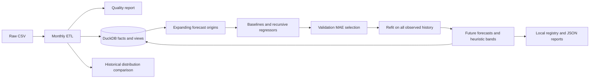

# AquaTrade MLOps

A local Python pipeline for exploring monthly aquaculture-related trade records,
persisting analytical facts in DuckDB, and comparing recursive forecasts with simple
baselines. It demonstrates reproducible ML evaluation and lightweight file-backed
model management. It is a portfolio prototype, with no hosted service or production
operations claim.

The forecasting problem is to predict the next H monthly values for one commodity,
partner aggregate, and nonnegative trade measure using observations available at the
forecast origin. The bundled labels describe US imports and exports; they do not
establish global bilateral trade coverage.

## Implemented capabilities and architecture

- CSV ingestion, schema checks, monthly aggregation, unit prices and trade balances.
- DuckDB facts, dimension views, partner summaries, and appended forecast history.
- Naive, seasonal naive, moving average, linear regression, Ridge, random forest,
  and gradient boosting candidates with chronological recursive validation.
- Local joblib registry, JSON experiment records and per-series evaluation reports.
- PSI distribution comparison with explicit insufficient-data handling.

The stack is Python 3.12, pandas, NumPy, DuckDB, scikit-learn, SciPy, joblib and pytest;
Ruff checks code style. Direct dependencies and transitive constraints are pinned.
Python 3.12 is the validated and CI-supported environment; other versions are unverified.

The existing layers are preserved: `domain` contains dataclasses and validation;
`use_cases` contains ETL, forecasting and orchestration; `infrastructure` contains CSV
and DuckDB access; `adapters` contains mapping and console presentation; `mlops`
contains local lifecycle utilities. This is a layered design inspired by Clean
Architecture, not strict dependency inversion or a complete DDD implementation:
application orchestration imports concrete infrastructure, and domain validation uses
pandas. Dimension objects are views over facts, not a normalized dimensional warehouse.



## Installation and reproducible execution

```bash
git clone https://github.com/karsterr/aquatrade-mlops.git
cd aquatrade-mlops
python3.12 -m venv .venv
source .venv/bin/activate
python -m pip install -r requirements-dev.txt
python -m pytest -q
ruff check .
ruff format --check .
```

For runtime only, install `requirements.txt`. Keep `constraints.txt` with both
requirements files. These pins reproduce the audit environment; update them together
and rerun validation when changing dependencies.

Expected input: `data/raw/Aquaculture_Trade_Filtered.csv`. Read the
[data dictionary and unresolved provenance/license status](docs/DATA.md) before reuse.
No dataset download service is implemented.

```bash
python main.py --step etl
python main.py --step inspect
python main.py --step stats
python main.py --step forecast --top-n 1 --horizon 12
python main.py --step models
python main.py --step runs
python main.py --step all --top-n 1 --horizon 12
```

`forecast` and `stats` require ETL persistence first. `all` performs ETL, inspection,
persistence, forecasting, and PSI and tracks the pipeline run. `inspect` reads and
transforms the CSV without saving facts. `--raw-path` and `--db-path` override input
and database paths; relative paths resolve from the repository root. `--top-n` and
`--horizon` require positive integers. The default evaluation window is 24 months;
horizons above that require configuring `AppConfig.default_test_split_months` through
Python. Series without enough history are reported and skipped. Invalid data or
unexpected training/persistence failures propagate, and tracked full runs are marked
failed. A run can legitimately have no forecasts; inspect its output and report count.
The bundled dataset currently causes the default top-ranked full run to stop on
missing targets. ETL/inspection remain usable; the named complete-series benchmark
below is the verified real-data forecasting path. A reporting policy is required
before running forecasts across incomplete top-ranked series.

Outputs are local under `data/processed`, `data/models`, `data/experiments` and
`data/reports`. New generated files are ignored. ETL replaces facts; forecasts append.
Use a temporary `AppConfig(base_dir=..., ...)` for isolated experiments, including
model, experiment and report directories. The CLI only exposes input/database paths.

## Forecast methodology and interpretation

The final evaluation window is divided into complete, nonoverlapping H-month blocks,
right-aligned to the last observed month. The effective window can be smaller than
24 months when H does not divide 24 or history is short. Each origin expands the
training prefix; all candidates receive exactly the same origins, targets and horizon.
At least 12 training months are required. Regressors participate only when the first
origin provides more than ten training rows after the 12-month lag warm-up; otherwise
all origins compare baselines only. The configured minimum total history is 36 months.

Features include shifted lags 1/2/3/6/12, shifted rolling summaries 3/6/12, calendar
seasonality and trend. Every ML evaluation step recursively feeds predictions back
into features, using the same helper as future inference. Future observations never
enter that origin's features. Negative model outputs are clipped to zero before
recursion and scoring; nonfinite outputs fail explicitly. Ridge uses a scaler fitted only on each training prefix. Models with random behavior
use seed 42. `LinearTrend` is retained as a legacy name for a linear regressor over
all engineered features, not a trend-only model.

Naive repeats the final value; seasonal naive repeats the last 12 months; moving
average repeats the final six-month mean. All are fixed-origin multi-step forecasts.
Selection uses unrounded MAE, which has the same within-series ranking as WAPE when
its denominator is positive. Stable ties favor earlier candidates, starting with
Naive. The winner is refit on full observed history for future predictions.

MAE and RMSE retain target units. WAPE is total absolute error divided by total
absolute actual value. MAPE averages relative error over **nonzero actuals only**;
it is sensitive to near-zero values and excludes zero-target errors, which MAE and
WAPE still include. Percentage metrics are stored as fractions. WAPE and MAPE are
undefined for all-zero targets; R² is undefined for fewer than two or constant targets.
Undefined values are NaN in Python and JSON null on disk. These definitions deliberately
replace epsilon-adjusted legacy metrics; old and new scores are not comparable.

Scores select models and are **validation results**, not an independent estimate of
the selected model's generalization performance. Top commodities are also selected
using full-history trade totals. Reserve an outer holdout and freeze series selection
before making accuracy claims. No ML superiority is assumed.

Bounds use validation RMSE/MAE and a square-root horizon multiplier. The legacy
`confidence_level` setting controls a normal multiplier only. These are **uncalibrated
heuristic uncertainty bands**, neither confidence intervals nor validated 95%
prediction intervals. No empirical coverage claim is made.

For a reproducible candidate comparison without mutating tracked stores, see
[the benchmark procedure](docs/BENCHMARK.md). Reports contain origins, horizon,
candidate metrics and uncertainty labels.

## Tracking, registry and monitoring

`all` writes a unique run record and SHA-256 of the complete transformed CSV
representation. It logs configuration, quality counts, runtime and aggregate champion
MAPE; undefined percentages persist as null. Each forecast writes a unique JSON report
with all candidate metrics and origins; active full runs link these reports.

Registry versions default to UUID-based identifiers. Explicit duplicate versions are
rejected. New paths are relative to the registry directory. Legacy absolute metadata
is preserved and may reference unavailable artifacts. Only load trusted joblib files:
deserialization can execute code. A stored estimator alone is not a self-contained
forecast serving bundle; history and feature/preprocessing contracts are still needed.

JSON files use atomic replacement, and corrupt indexes raise errors. Stores assume
one writer; there is no cross-file transaction, concurrent writer lock, or automatic
recovery from interrupted runs. Individual RUNNING records survive a process crash;
only finalized runs appear in the summary index. Direct `forecast` writes reports
and registry versions but does not create an experiment run.

PSI compares distributions, not model accuracy. The orchestrator retains a fixed
2010 historical/recent split, which is an exploratory comparison, not online drift
monitoring. At least ten finite observations per population are needed; no eligible
features yields INSUFFICIENT_DATA. Thresholds 0.1/0.25 are heuristics, not hypothesis
tests. Commodity mixtures, missing values and seasonality can confound the comparison.

## Tests, CI and limitations

Tests use isolated temporary storage and synthetic data, including end-to-end
forecasting, leakage regression, horizon handling, zero/missing observations, ETL,
DuckDB, registry, tracker, PSI and CLI errors. GitHub Actions runs pytest and Ruff on
pull requests and pushes to main with read-only permissions and no secrets. Local
validation and remote CI status are reported separately in the engineering report.

The raw data is historical, has missing classifications and incomplete measures, and
has unresolved provenance and redistribution rights. Missing months are rejected,
not silently filled. The pipeline has no API, deployment, scheduler, alert service,
or concurrent storage guarantees. Data quality warnings do not automatically block
persistence. Software has **no license file**; the owner must choose terms separately
from dataset rights. MIT or Apache-2.0 are options to consider; neither is applied.

Next priorities: establish data rights and reporting semantics, reserve independent
holdouts, package reproducible inference history/contracts, calibrate uncertainty on
separate origins, and improve interrupted-run recovery. Detailed findings and
prioritized debt are in [the engineering audit](docs/ENGINEERING_AUDIT.md).
